<p align="center">
  
</p>

<p align="center">
  
</p>

<h3 align="center"><i>"Gravity is just attention that refuses to let go."</i></h3>

<br/>

### ◉ &nbsp;event horizon

My name used to live on the street walls. Now it lives here.

I edit videos. I bend time on a timeline, cut the silence and keep only what pulls you in, like a black hole does with light.

When the tool I need doesn't exist yet, I don't wait for it. I build it, with **Claude** as my co-pilot.

> **Status:** drifting through Premiere, After Effects and Photoshop, one frame at a time.

<br/>

### ✦ &nbsp;in my orbit

<p align="center">
  
</p>

<br/>

### ☄ &nbsp;mission log

```txt
[ ok ] learn the timeline             → Premiere Pro
[ ok ] make things move               → After Effects
[ .. ] make every frame look intentional
[ .. ] build the tools nobody made yet
[ ?? ] reach the singularity
```

<br/>

<p align="center">
  
</p>
