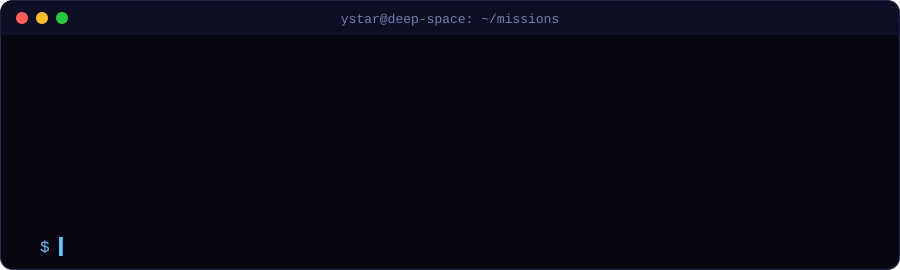
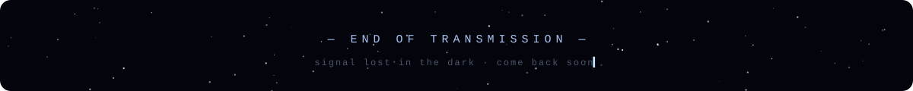

  

<h3 align="center"><i>"Gravity is just attention that refuses to let go."</i></h3>

### ◉ &nbsp;event horizon

Some people look at the stars. I fall into them.

I edit videos. I bend time on a timeline, cut the silence and keep only what pulls you in, the way a black hole pulls in light.

When the tool I need doesn't exist yet, I don't wait for it. I build it, with **Claude** as my co-pilot.

> **Status:** drifting through Premiere, After Effects and Photoshop, one frame at a time.

### ✦ &nbsp;in my orbit

  

### ☄ &nbsp;mission log

  

### ⌁ &nbsp;signal

  
  
  

 

  

